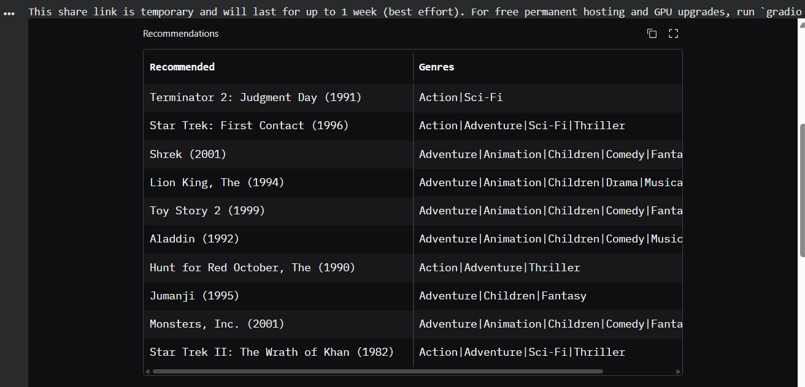
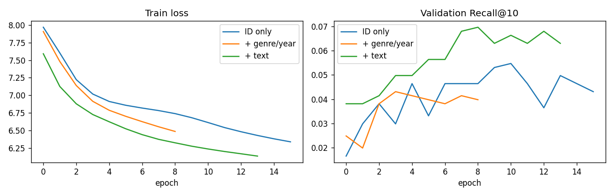

# 🎬 Two-Tower Movie Recommender

A two-tower neural recommender built from scratch in PyTorch on MovieLens, evaluated with full-catalog ranking and compared against a popularity baseline and ablations of the feature set.

[](https://colab.research.google.com/github/YOUR_USERNAME/YOUR_REPO/blob/main/two_tower_recommender.ipynb)



## Problem
Given the movies a user has liked (rating ≥ 4), recommend movies they are likely to enjoy next. Ratings are treated as implicit feedback.

## Dataset
[MovieLens ml-latest-small](https://grouplens.org/datasets/movielens/latest/) (GroupLens): ~100k ratings, ~9.7k movies, ~600 users. Users with fewer than 5 positive interactions are removed.

## Method
- **Split:** per-user temporal leave-one-out. The last liked movie is the test item, the second to last is validation, and the rest is training.
- **Model:** a user tower and an item tower. Each combines an ID embedding with content features, passes them through a small MLP, and outputs an L2-normalized 32-d vector. The score is the dot product.
  - Item features: genres (multi-hot), release year, and a 384-d sentence embedding (`all-MiniLM-L6-v2`) of *title + genres + top user tags*.
  - User features: genre profile and mean text embedding of the movies the user liked, computed from **training interactions only** (no leakage).
- **Loss:** in-batch sampled softmax with temperature and logQ popularity correction; same-item collisions in a batch are masked.
- **Model selection:** early stopping on validation Recall@10.
- **Evaluation:** for each user, rank *all* movies they have not interacted with and measure where the held-out movie lands (Recall@K, NDCG@K). No sampled negatives.

## Results (test set, single run, seed 42)

| Model | Recall@10 | NDCG@10 | Recall@20 | NDCG@20 |
|---|---|---|---|---|
| Popularity | 0.0381 | 0.0200 | 0.0680 | 0.0274 |
| Two-Tower (ID only) | 0.0531 | 0.0239 | 0.0796 | 0.0306 |
| Two-Tower (ID + genre/year) | 0.0431 | 0.0216 | 0.0746 | 0.0296 |
| Two-Tower (ID + genre/year + text embeddings) | 0.0531 | 0.0233 | **0.1144** | **0.0386** |



## Takeaways
- The ID-only and text-enhanced models beat the popularity baseline, so the model learns personalized signal beyond "recommend what is popular".
- Adding sentence embeddings of title, genres and tags gave the clearest improvement at K=20 (Recall 0.114 vs 0.080 for ID-only). At K=10 it matched ID-only.
- Genre and year features alone did not help over ID-only, likely because they carry little information compared to text/tag embeddings.
- The text model also reaches a lower training loss and higher validation Recall faster (see curves).

## Limitations
- **Small test set:** ~600 users, one held-out item each. Recall@10 = 0.053 corresponds to about 32 users, so differences at K=10 are within noise.
- **Single run:** results come from one seed; no confidence intervals. The K=20 gain is promising but should be confirmed with multiple seeds.
- Small dataset; results may not transfer to larger catalogs.
- Text features come only from titles, genres and tags.
- Hyperparameters were lightly tuned.

## Repository structure
```
├── two_tower_recommender.ipynb   # full pipeline: data → model → evaluation → demo
├── requirements.txt
├── results.csv
├── training_curves.png
└── demo.png
```

## How to run
Click the Colab badge above, set `Runtime → Change runtime type → T4 GPU`, then `Runtime → Run all`. The notebook downloads the data automatically and finishes with an interactive Gradio demo (recommendations per user and similar-movie search).

## Possible next steps
- Multiple seeds and bootstrap confidence intervals
- Hard-negative mining and hyperparameter search
- Cold-start evaluation
- Approximate nearest-neighbor retrieval (FAISS) for serving
- Larger dataset (MovieLens 1M/25M) and richer text features

## Acknowledgements
Data: F. Maxwell Harper and Joseph A. Konstan, *The MovieLens Datasets: History and Context*, ACM TiiS 2015. Text embeddings: Sentence-Transformers.
